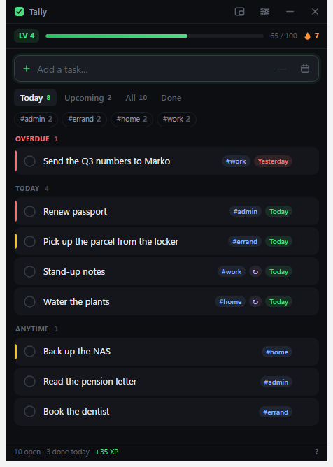

# Tally

A small, dark, keyboard-first task list for Windows. One box to type into, one
list to work through, and a level and streak that tick up as you finish things.



## Install

Run `dist/Tally-Setup-1.0.0.exe`. It installs per-user (no admin prompt), adds a
Start Menu and desktop shortcut, and can be uninstalled from Settings › Apps.

`dist/Tally-1.0.0-portable.exe` is the same app with no installer — double-click
and it runs.

## Adding a task

Type it and press <kbd>Enter</kbd>. Everything beyond the title is optional, and
a preview under the box always shows what Tally understood before you commit.

| You type | What you get |
| --- | --- |
| `#work` | a tag, anywhere in the line |
| `!` / `!!` | important (+10 XP) / urgent (+20 XP); plain tasks are +5 |
| `today` `tomorrow` `fri` | a due date — recognised at the end of the line |
| `in 3 days` `next week` | a relative due date |
| `25.9` `25.9.2026` `2026-09-25` | an exact date, day first |
| `every day` `every weekday` `every mon, thu` | repeats; a fresh copy appears when you finish one |

So `Renew passport !! #admin 25.9` becomes an urgent task tagged `#admin`, due
25 September.

Dates and repeats are only read off the **end** of the line, so an ordinary
title like `Read today's paper` is left alone. The buttons on the right of the
box do the same job with the mouse.

## Keys

| Key | |
| --- | --- |
| <kbd>Enter</kbd> | add the task — or, with an empty box, finish the selected one |
| <kbd>↑</kbd> <kbd>↓</kbd> | move the selection |
| <kbd>Space</kbd> | finish the selected task (empty box) |
| <kbd>Del</kbd> | delete the selected task (empty box) |
| <kbd>F2</kbd> | rename the selected task |
| <kbd>Alt</kbd>+<kbd>1…3</kbd> | normal / important / urgent |
| <kbd>Ctrl</kbd>+<kbd>Z</kbd> | undo — including finishing a task |
| <kbd>Ctrl</kbd>+<kbd>1…4</kbd> | Today / Upcoming / All / Done |
| <kbd>Ctrl</kbd>+<kbd>K</kbd> | compact always-on-top mode |
| <kbd>F1</kbd> | shortcuts and syntax |

The typing box keeps focus, so you can always just start typing.

## Levels and streaks

Finishing a task pays XP based on its priority. Level 2 costs 40 XP and each
level after that costs 20 more than the last. Finish at least one task on a day
and your streak grows; miss a day and it goes back to zero. Nothing nags you —
the status bar mentions the streak only when it is about to lapse.

## Windows behaviour

- **Close hides to the tray** so the app stays a click away. Turn it off in
  Settings to make the close button quit instead; Quit is always in the tray menu.
- **Launch when I sign in** registers a normal per-user startup entry, optionally
  starting hidden in the tray.
- **Compact mode** (the button left of the settings icon, or <kbd>Ctrl</kbd>+<kbd>K</kbd>)
  shrinks the window to a narrow strip pinned above other windows.

## Your data

Everything lives in one file:

```
%APPDATA%\Tally\data.json
```

It is written atomically — a temporary file is written, flushed to disk and then
renamed — so an unexpected shutdown cannot leave a half-written file. If the
file is ever unreadable, Tally keeps a copy as `data.corrupt-<timestamp>.json`
next to it rather than overwriting it, and starts fresh.

Settings has **Export…** and **Import…** buttons for a plain JSON backup, and
**Show folder** to open the location in Explorer.

## Building from source

```bash
npm install
npm start          # run in place
npm run dist       # build the installer + portable exe into dist/
npm run icon       # regenerate build/icon.ico
```

Requires Node 18+. `npm install` under npm 9+ may skip Electron's download
script; if `node_modules/electron/dist` is missing, run
`node node_modules/electron/install.js`.

## Layout

```
src/main/main.js        window, tray, login item, IPC
src/main/store.js       atomic JSON persistence and input sanitising
src/main/preload.js     the only bridge into the renderer
src/renderer/app.js     state, rendering, keyboard handling
src/renderer/lib/       dates, the typed-input parser, XP rules, sound, confetti
tools/make-icon.js      generates the .ico from scratch (no image libraries)
```

The renderer runs sandboxed with no Node access and a strict Content Security
Policy; user text is only ever written through `textContent`, never as HTML.
